# Bitácora Día 14 · [RPA + n8n]

**Fecha: 21 de Octubre**
**Horas invertidas:** autoinvestigación 4 h · práctica 2 h · reto 2 h

## Autoinvestigación básica

1. Pregunta: ¿Qué es RPA? Bots atendidos vs no atendidos.
   Respuesta: RPA (Robotic Process Automation) es software que imita lo que hace una persona frente a una pantalla (clics, teclado, copiar y pegar) para ejecutar tareas repetitivas basadas en reglas, sin modificar la aplicación. Un bot atendido corre en el equipo de la persona, la ayuda y se dispara cuando ella lo pide. Un bot no atendido corre solo en un servidor o máquina virtual, programado o por eventos, sin nadie al frente.

2. Pregunta: ¿Cuándo usar RPA y cuándo una integración por API? Riesgos del RPA.
   Respuesta: Si existe una API estable se usa la API: es más rápida, más robusta y entrega datos estructurados. El RPA se usa cuando no hay API (sistemas heredados, programas de escritorio, portales de terceros) o no se puede tocar la aplicación. Sus riesgos son que un cambio de pantalla lo rompe, es frágil (selectores, tiempos de carga, ventanas emergentes), cuesta mantenerlo y maneja credenciales que hay que proteger.

3. Pregunta: Herramientas: UiPath, Power Automate Desktop, Automation Anywhere, Robot Framework, Python (Playwright/Selenium, pyautogui).
   Respuesta: UiPath y Automation Anywhere son plataformas empresariales de RPA con diseñador visual y orquestador para administrar muchos bots. Power Automate Desktop es la opción de Microsoft para Windows y encaja bien si ya se usa su ecosistema. Robot Framework es de código abierto y se escribe con palabras clave. Con Python, Playwright o Selenium automatizan sitios web, y pyautogui controla el escritorio por coordenadas (el más frágil de todos).

4. Pregunta: ¿Qué es n8n? Nodos, triggers, ejecuciones, credenciales.
   Respuesta: n8n es una plataforma de automatización de flujos de trabajo con poco código que se puede instalar en un servidor propio. Un flujo es una cadena de nodos (pasos). El trigger es el nodo que inicia el flujo (webhook, manual, programado). Cada corrida es una ejecución y guarda los datos que pasaron por cada nodo. Las credenciales son los secretos de cada servicio y n8n los guarda cifrados, separados del flujo.

5. Pregunta: Webhooks: qué son y cómo funcionan.
   Respuesta: Un webhook es una URL que una aplicación llama (normalmente un POST con JSON) cuando ocurre un evento, para avisar a otra en el momento, en lugar de que la otra pregunte cada cierto tiempo. El receptor responde rápido con un 2xx y se protege con un secreto o una firma para saber que el aviso es legítimo. En el proyecto, la API llama al webhook de n8n cada vez que se crea un pedido.

## Autoinvestigación avanzada

1. n8n: expresiones, nodo Code, IF/Switch, Merge, Loop, manejo de errores y Error Workflow.
   Las expresiones se escriben entre `{{ }}` y leen datos de nodos anteriores (`$json`, `$('Nodo').first().json`) o variables de entorno (`$env`). El nodo Code ejecuta JavaScript o Python cuando un nodo estándar no alcanza. IF y Switch dividen el flujo en ramas según una condición. Merge junta ramas. Loop Over Items procesa elementos en lotes. Para los errores, cada nodo puede detener el flujo, continuar, o enviar el error por una salida aparte (continue error output), y además se pueden configurar reintentos. El Error Workflow es otro flujo, que empieza con un Error Trigger, y se ejecuta cuando falla cualquier flujo que lo tenga asignado en su configuración.

2. n8n self-hosted en Docker, persistencia y variables de entorno.
   Se usa la imagen `docker.n8n.io/n8nio/n8n`. Para no perder flujos y credenciales se monta un volumen en `/home/node/.n8n`, donde guarda su base de datos (SQLite por defecto). Variables importantes: `WEBHOOK_URL` (la URL pública de los webhooks), `N8N_ENCRYPTION_KEY` (cifra las credenciales: si cambia, las guardadas dejan de poder leerse), `GENERIC_TIMEZONE`, `N8N_PORT` y `N8N_RESTRICT_FILE_ACCESS_TO` (limita a qué carpetas pueden acceder los nodos de archivos).

3. Buenas prácticas: idempotencia, reintentos, logs, no exponer credenciales.
   Idempotencia: repetir el mismo pedido no debe duplicar nada (el flujo busca en Zoho antes de crear y la tabla de logs tiene un índice único para los resultados "ok"). Reintentos: los nodos que llaman a Zoho reintentan 3 veces con espera. Logs: cada intento queda en la tabla `log_integraciones`, además del historial de ejecuciones de n8n. Credenciales: nunca dentro del JSON del flujo ni en el repositorio; van en variables de entorno o en las credenciales cifradas de n8n, y el webhook exige un secreto compartido.

4. RPA con Playwright: selectores robustos, esperas, capturas en error.
   Selectores por rol, etiqueta o id (`get_by_label`, `get_by_role`), no por posición ni por clases de estilo. Esperas explícitas (`expect`, `wait_for_selector`) en vez de `sleep`, porque Playwright espera a que el elemento esté listo. Captura de pantalla cuando algo falla para saber en qué estado quedó la página.

## Ejercicios

### Básico: n8n en Docker y flujo "Manual Trigger → HTTP Request → archivo"
Levanté n8n con Docker Compose. El flujo pide los productos a la API (`GET /productos`), los convierte a archivo y los guarda en `proyecto/n8n/salida/productos.json`.

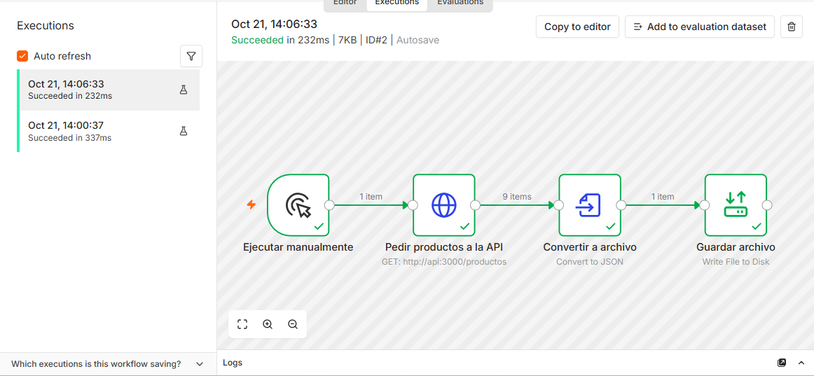

### Intermedio: bot Playwright que llena un formulario
`proyecto/rpa/practica_formulario.py` entra al formulario de pruebas de Selenium, lo llena, lo envía y comprueba que la página diga "Received!".

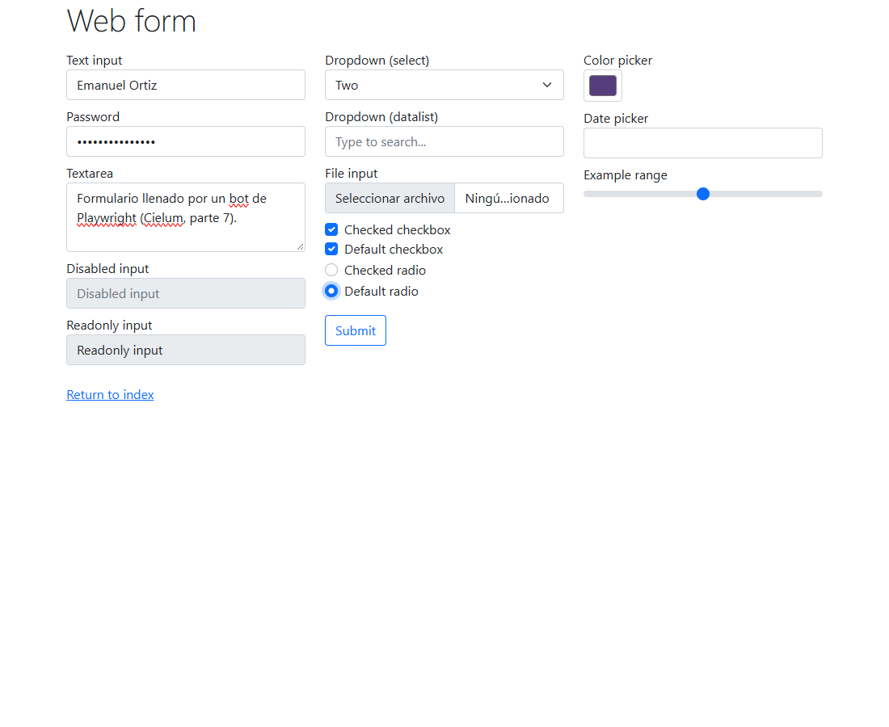

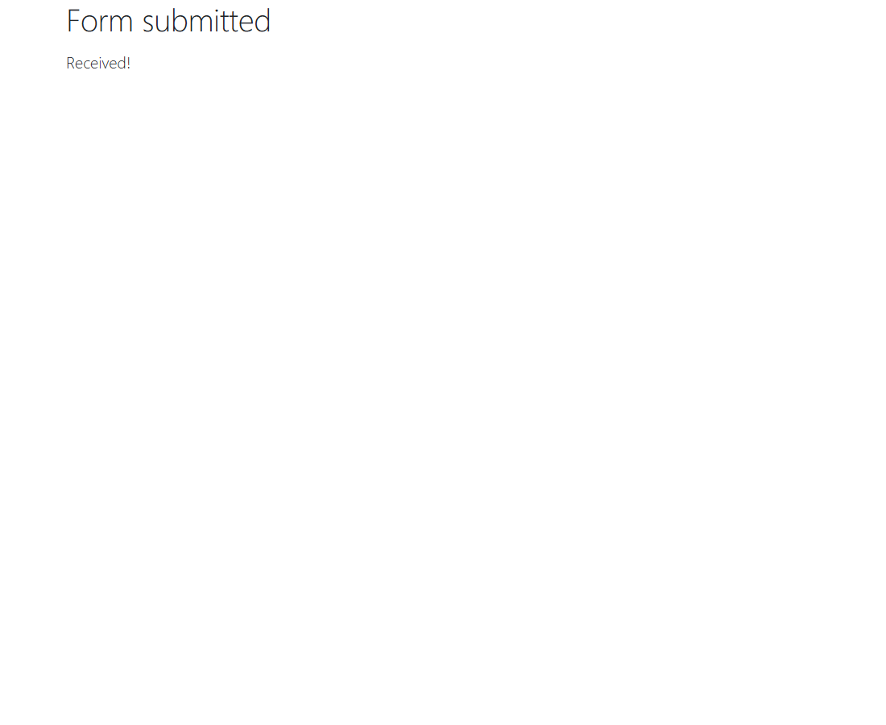

### Avanzado: Error Workflow que avisa por correo
Creé el flujo "Aviso de error por correo" (Error Trigger → enviar correo), lo publiqué y lo asigné como Error Workflow del flujo `Pedido a Zoho` (en esta versión de n8n, si el Error Workflow no está publicado no se ejecuta). Para probarlo provoqué un fallo apagando Postgres y el aviso llegó al buzón de pruebas (Mailpit).

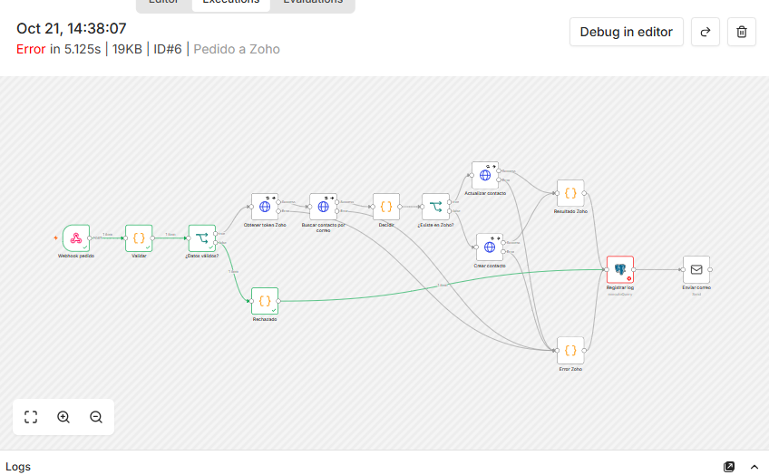

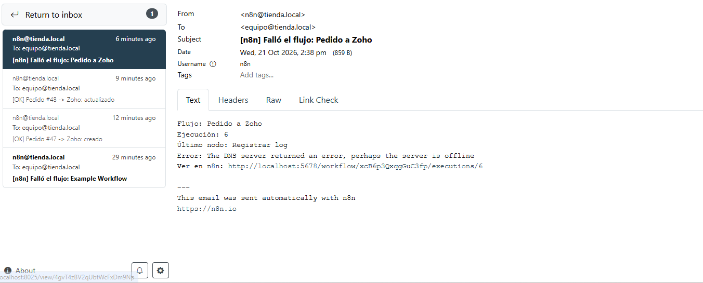

## Reto del día

**1. Flujo `proyecto/n8n/pedido-a-zoho.json`:** el Webhook recibe el pedido → valida el secreto y los datos → pide el token de Zoho → busca el contacto por correo → si no existe lo crea y si existe lo actualiza → registra el resultado en `log_integraciones` (PostgreSQL) → envía un correo de notificación. Cada llamada a Zoho reintenta 3 veces y, si sigue fallando, el error también se registra y se notifica.

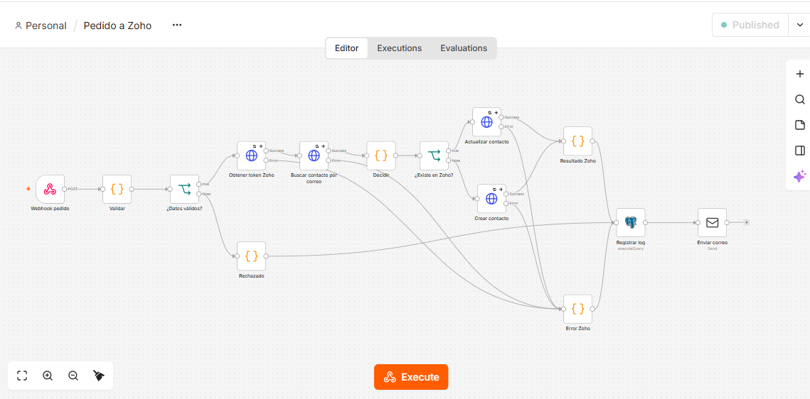

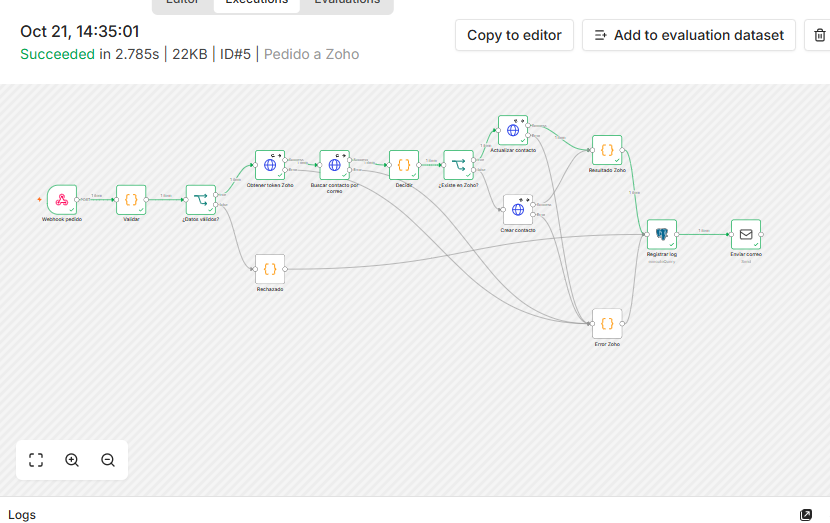

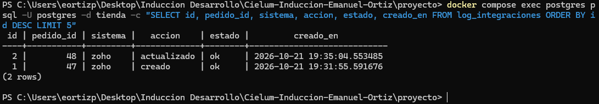

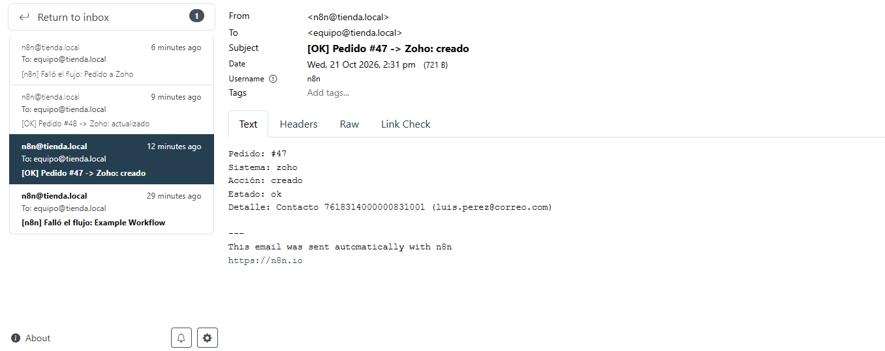

**2. La API llama al webhook:** `proyecto/api/integraciones.js` envía el pedido a n8n justo después de crearlo (con un secreto en la cabecera `X-Webhook-Secret`). Si n8n no responde, el pedido igual queda guardado y solo se registra un aviso en el log de la API.

**3. Bot `proyecto/rpa/reporte_pedidos.py`:** entra al frontend con un usuario de prueba, recorre el listado de pedidos y genera `reporte_diario.xlsx`. En `proyecto/rpa/README.md` documenté por qué esto en la vida real se haría mejor por API y cuándo sí se justifica el RPA.

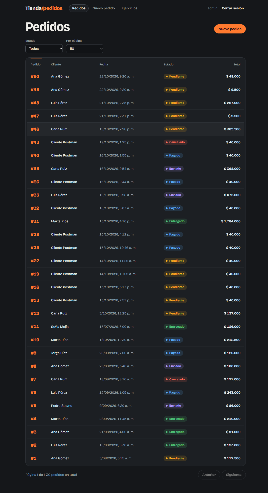

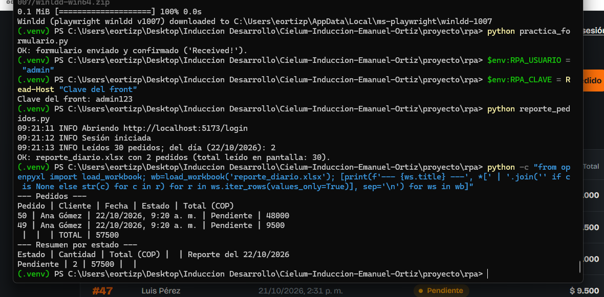

**4. n8n en `docker-compose.yml`:** servicios `n8n` y `mailpit` (buzón de pruebas), con volumen para no perder los flujos.

## Lo que aprendí hoy

## Lo que no entendí o me costó

## Errores que tuve y cómo los resolví

| Error | Causa | Solución |
|---|---|---|

## Uso de IA hoy
Sí, la usé para armar los flujos de n8n, los bots de Playwright, los archivos del proyecto y revisar conceptos.

## Autoevaluación del tema (1-5): 4
