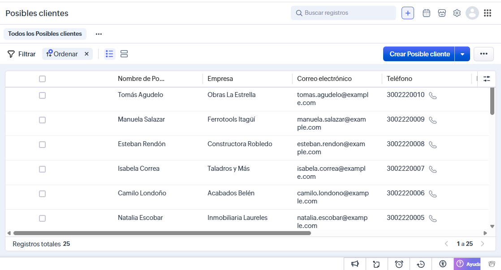
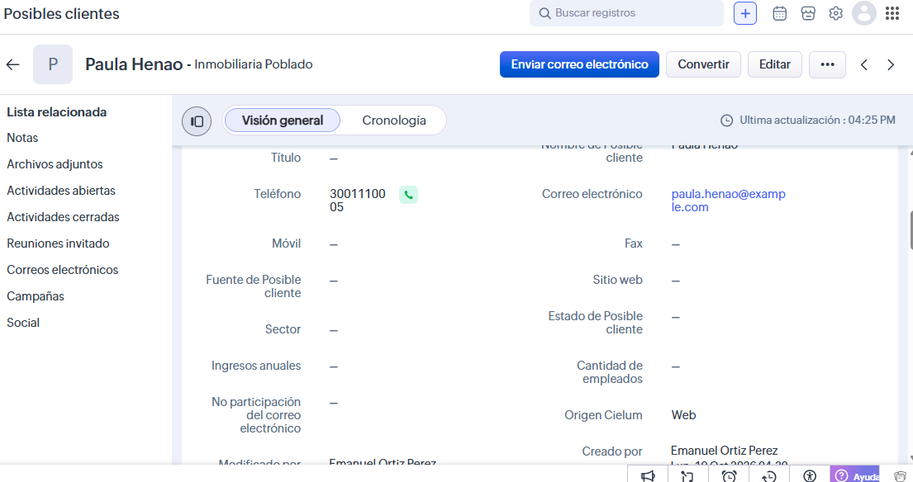
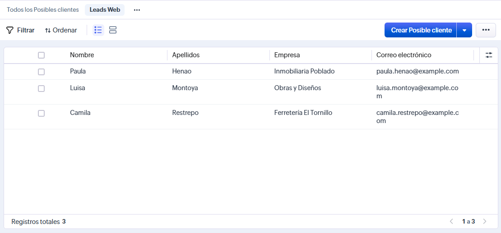
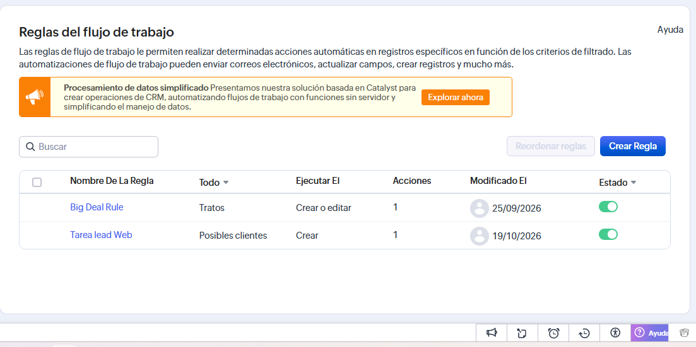
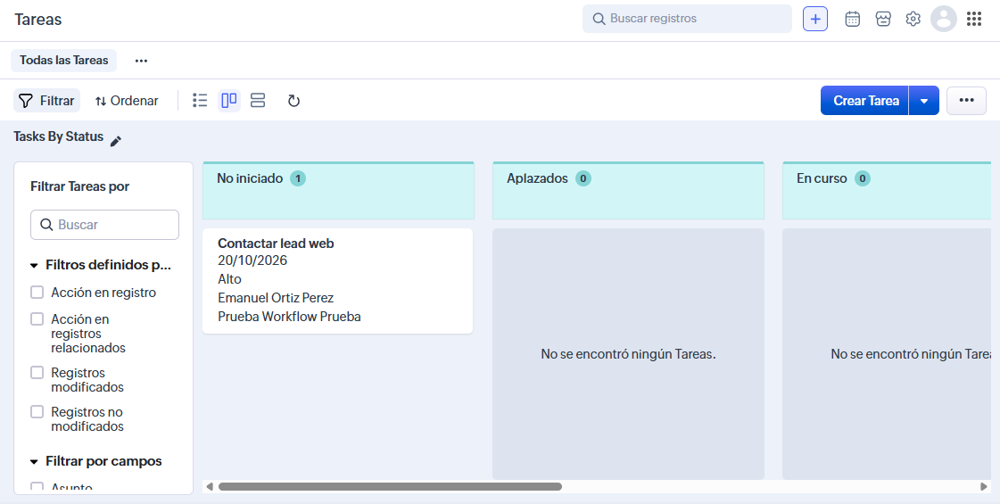
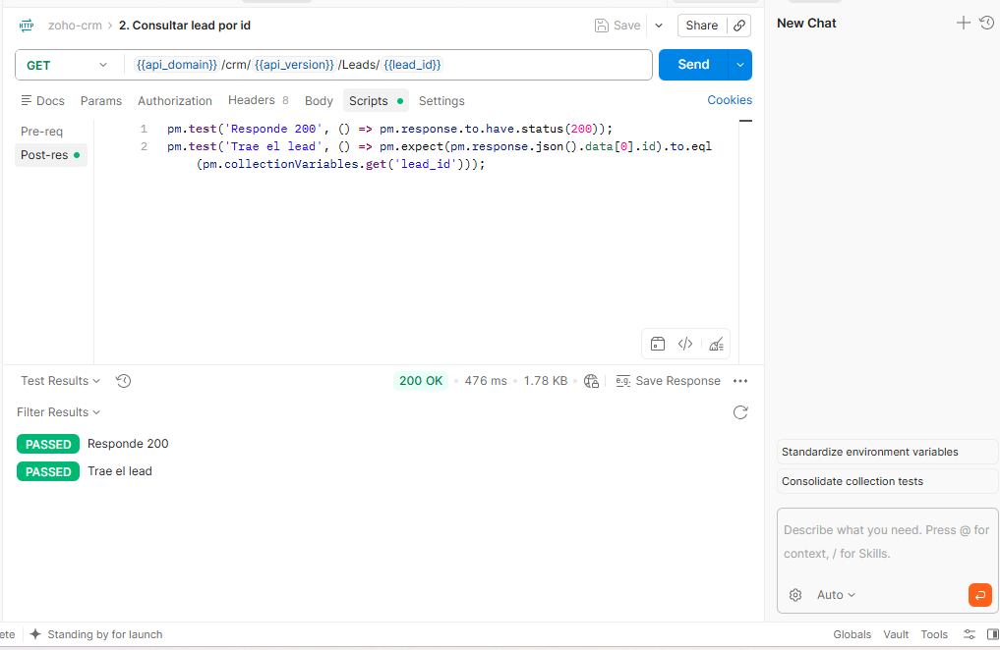
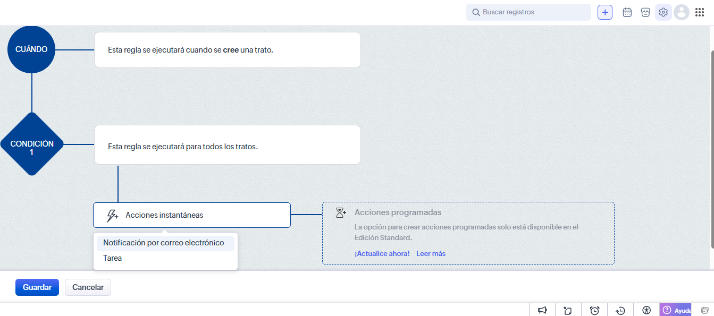

# Zoho CRM: configuración y API (parte 6)

Cuenta de prueba de Zoho CRM. Aquí queda la evidencia de lo configurado, la colección de Postman y la función Deluge.

## 1. Leads de prueba
- 10 leads ficticios: 5 creados a mano y 5 por importación CSV.
- Archivo CSV usado: `leads.csv` (misma carpeta).

> Captura 1: lista de Leads con los 10 registros.
> `capturas/01-leads.png`



## 2. Campo personalizado "Origen Cielum"
- Tipo: lista de selección. Valores: Web, Referido, Evento.
- Se agregó al layout de Leads.



## 3. Vista filtrada
- Nombre de la vista: `Leads Web`.
- Filtro: Origen Cielum = Web.



## 4. Workflow
- Módulo: Leads. Se ejecuta al crear un registro.
- Condición: Origen Cielum = Web.
- Acción: crear una tarea asignada al dueño del lead ("Contactar lead web").





## 5. API con Postman
Colección: `zoho-crm.postman_collection.json`. No lleva tokens reales: todo va en variables de la colección.

| Variable | Qué es |
|---|---|
| `client_id`, `client_secret` | Del Self Client (api-console.zoho.com) |
| `grant_code` | Código de un solo uso del Self Client; se usa solo en la petición 0 |
| `refresh_token` | No vence; se guarda tras la petición 0 |
| `access_token` | Dura 1 hora; se renueva solo |
| `accounts_url`, `api_domain` | Según el centro de datos de la cuenta (`.com`, `.eu`, `.in`...) |
| `api_version` | Versión de la API vigente en la documentación |

Cómo se renueva el token solo: la colección tiene un script *pre-request* que, antes de cada petición, mira si el access token ya venció y, si es así, pide uno nuevo con el refresh token (`grant_type=refresh_token`).

Peticiones: 0 obtener tokens, 1 crear lead, 2 consultar por id, 3 listar, 4 actualizar, 5 buscar por email, 6 buscar por criterio.



## 6. Función Deluge
**Qué hace:** cuando se crea un Deal, copia su nombre en la descripción del Contact asociado.

**Estado:** diseñada y documentada, **no ejecutada**. La cuenta de prueba (edición gratuita) no permite funciones personalizadas: en una regla de flujo de trabajo sobre Tratos, las únicas acciones instantáneas disponibles son *Notificación por correo electrónico* y *Tarea* (ver captura). Tampoco hay acciones programadas.

**Cómo se conectaría:** regla de flujo de trabajo sobre Deals (Tratos) al crear → acción instantánea "Función" → argumento `dealId` = ID del Deal.

```deluge
// Argumento: dealId (ID del Deal)
deal = zoho.crm.getRecordById("Deals", dealId);
contacto = deal.get("Contact_Name");
if(contacto != null)
{
    contactoId = contacto.get("id");
    cambios = Map();
    cambios.put("Description", "Último deal: " + deal.get("Deal_Name"));
    respuesta = zoho.crm.updateRecord("Contacts", contactoId, cambios);
    info respuesta;
}
return "";
```

Paso a paso: 1) lee el Deal por id; 2) saca el contacto asociado; 3) si hay contacto, arma un mapa con el campo a cambiar; 4) actualiza el Contact; 5) `info` deja la respuesta en el log para revisar.



## 7. Conclusiones
- El workflow evita crear tareas a mano cuando entra un lead web.
- Con la API se pueden automatizar altas y consultas sin entrar a la interfaz.
- El refresh token permite que la colección siga funcionando sin volver a generar el código del Self Client.
- Limitación: la edición gratuita de Zoho CRM no incluye funciones personalizadas (Deluge), por eso la función quedó documentada pero sin ejecutar.
